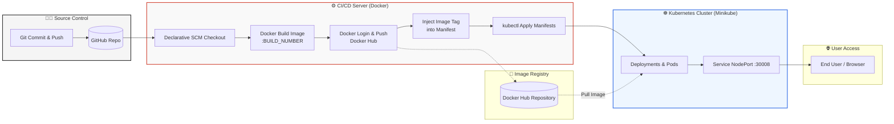
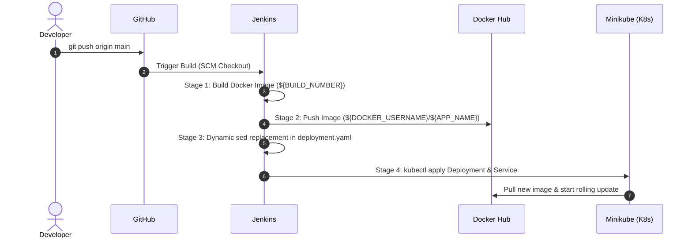

# 🚀 Automated CI/CD Pipeline for Containerized Python App on Kubernetes

<p align="center">
  
  
  
  
  
</p>

An enterprise-grade, end-to-end CI/CD pipeline automating the lifecycle of a Python web application—from source code versioning to automated container building, Docker Hub image publishing, and seamless deployment onto a Kubernetes cluster.

---

## 📌 Architecture & Workflow



---

## 🛠️ Tech Stack & Prerequisites

* **Application:** Python 3.9 (Flask Web Server).
* **Containerization:** Docker Engine & Dockerfile.
* **Orchestration:** Kubernetes (Minikube).
* **Automation Server:** Jenkins (Running in Docker container).
* **Artifact Registry:** Docker Hub (`adawy123/new-app-nti`).
* **Environment:** Ubuntu (WSL2 / Linux).

---

## 📁 Repository Structure

```text
├── Dockerfile              # Container image specifications
├── Jenkinsfile             # Declarative Jenkins CI/CD pipeline script
├── Python.py               # Main Python application entrypoint
├── req.txt                 # Application dependencies
└── k8s/
    ├── deployment.yaml     # Kubernetes Deployment manifest (dynamic image tag)
    └── service.yaml        # NodePort Service to expose the app
```

---

## ⚙️ Pipeline Stages Breakdown



1. **SCM Checkout:** Automatically clones the latest commit from `main`.
2. **Build Docker Image:** Builds the lightweight Python container image tagged with `${BUILD_NUMBER}`.
3. **Push Docker Image:** Securely authenticates via Jenkins Credentials and publishes the image to Docker Hub.
4. **Deploy to Kubernetes:** 
   * Replaces `IMAGE_PLACEHOLDER` dynamically using `sed`.
   * Applies Deployment and NodePort Service manifests via `kubectl`.

---

## 🔍 Validation & Verification

After the pipeline finishes with `SUCCESS`, verify your deployment:

```bash
# Check Pod status
kubectl get pods -l app=python-app

# Inspect running container image
kubectl describe deployment python-app-deployment | grep Image

# Expose or verify the Service URL
minikube service python-app-service --url
```

---

## 👤 Author
* **Ahmed Ibrahim Adawy** - [GitHub Profile](https://github.com/AdawyDevOps)
